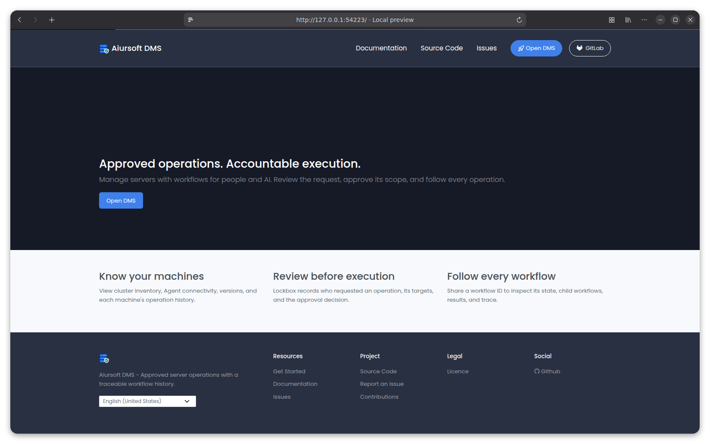

# DMS

[](./LICENSE)
[](https://gitlab.aiursoft.com/aiursoft/dms/-/pipelines)
[](https://gitlab.aiursoft.com/aiursoft/dms/-/pipelines)
[](https://s360.aiursoft.com/SupplyChain?tab=projects&project=aiursoft%2Fdms&scope=baseline&ecosystem=all)
[](https://manhours.aiursoft.com/r/github.com/aiursoftweb/dms.html)

DMS is a server operations platform for humans and AI, built on Aiursoft Template. Request an operation, approve its scope through Lockbox, and follow its execution across your machines.



## Overview

### What is DMS?

- A web console for machine inventory, approvals and workflow history.
- A CLI and reusable SDK for requesting operations and inspecting their results.
- Linux Agents that connect outward to the Controller over WebSocket. Managed machines need access to the Controller, without requiring internet access or an SSH service.
- Cluster permissions with independent request, automatic approval and approval rights for five risk levels.
- Persistent workflow state, parent/child callstacks and ClickHouse trace archives.
- Shared Aiursoft accounts, OIDC, roles, themes and localization.

The current workflows cover approved Agent upgrades and status, scoped Box Puller mirror updates, performance information, service status and restart, block devices, local filesystem capacity, machine inventory and registration. Operational commands submit a Lockbox; inspection and approval commands use authenticated management APIs. Arbitrary shell commands are not exposed.

## CLI & SDK

Install the CLI with the [.NET 10 SDK](https://dotnet.microsoft.com/download/dotnet/10.0):

```sh
dotnet tool install --global Aiursoft.DMS.Client
dms --help
```

Sign in to your Controller and create a personal key under **API Keys**. In Bash, configure access and check your identity:

```sh
export DMS_SERVER=https://dms.aiursoft.com/
read -rsp 'DMS personal API key: ' DMS_API_KEY
echo
export DMS_API_KEY
dms access whoami
dms cluster list
```

The CLI uses table output by default; add `--output-format json` or `csv` for structured output. Identity and inventory-directory queries do not create Lockboxes. Server operations still require their Cluster's risk permissions and Lockbox approval.

Use `dotnet tool update --global Aiursoft.DMS.Client` to update or `dotnet tool uninstall --global Aiursoft.DMS.Client` to uninstall. See [CLI and Agent setup](./docs/cli-and-agent.md) for PATH configuration, authentication, approvals and operation examples. The [SDK source](./src/Aiursoft.DMS.SDK) is included in this repository and is not published as a separate NuGet package.

## Run manually

Requires [.NET 10 SDK](https://dotnet.microsoft.com/download/dotnet/10.0) and [Node.js](https://nodejs.org/).

```sh
cd src/Aiursoft.DMS/wwwroot
npm ci
npm run build
cd ..
dotnet run --project Aiursoft.DMS.csproj -- --urls http://localhost:5000
```

Open `http://localhost:5000`. The default local administrator is `admin@default.com` with password `Admin@123456!`. Change this password before exposing a deployment.

The defaults use SQLite and local accounts. Create a personal key under **API Keys**. Use the CLI to create clusters, configure their permissions and issue cluster join keys; **Cluster access** provides the same management operations in the web UI. See [CLI and Agent setup](./docs/cli-and-agent.md) for registration and the first operation.

## Run in Microsoft Visual Studio

Open `Aiursoft.DMS.sln`, select `Aiursoft.DMS` as the startup project, and press **F5**. Install the frontend dependencies as described above first.

## Run in Docker

Build a Controller image from the repository root:

```sh
docker build --tag dms:local .
docker run -d --name dms --restart unless-stopped \
  -p 8080:5000 -v dms-data:/data dms:local
```

Open `http://localhost:8080`. Persist `/data` for the default SQLite database, configuration, uploaded files and workflow state. The health endpoint is `/health`.

| Property | Value |
| --- | --- |
| Container port | `5000` |
| Binary directory | `/app` |
| Persistent data | `/data` |
| Configuration | `/data/appsettings.json` |
| Workflow state | `/data/dms-state` |

The shared CI validates Linux amd64 and arm64 images. Once a successful master pipeline publishes `aiursoft/dms:latest`, the standard [installer](./install.sh) can install that image with a chosen port:

```sh
sudo bash install.sh 8080
```

The Controller image includes self-contained Linux x64 and arm64 Agent bundles. Run its installation command once on each managed host, then approve registration through Lockbox. See [Agent installation](./docs/cli-and-agent.md#install-and-join-an-agent).

## Configuration

Run one Controller with a persistent business database and workflow state directory. Configure ClickHouse for detailed workflow traces before using the service for ongoing operations. Local accounts are the development default; OIDC is an explicit deployment setting.

See [configuration and persistence](./docs/configuration.md) for database settings, trace storage, authentication, recovery and cancellation behavior.

## How to contribute

Report bugs and feature requests through the [issue tracker](https://github.com/AiursoftWeb/dms/issues). Use a feature branch or fork and submit a merge request.

Build and test from the repository root:

```sh
dotnet build Aiursoft.DMS.sln
dotnet test Aiursoft.DMS.sln
./lint.sh
```

NugetNinja maintains the shared Template files and dependency conventions through `ninja.yaml`. External contributors use the checked-in public NuGet/npm sources; company CI selects the internal build sources separately.

## Credits

Built on [Aiursoft Template](https://github.com/aiursoftweb/template). Licensed under the [MIT License](./LICENSE).
